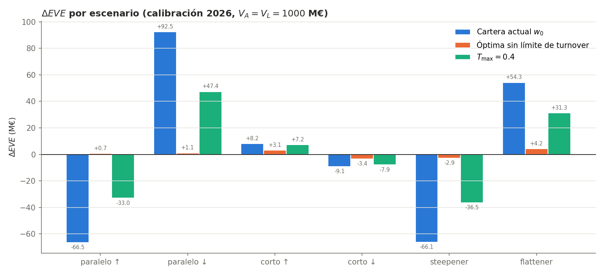

# Duration Matching: optimización de la cartera de un banco

Proyecto final de **Optimización y Heurística** (Grado en Ciencia e Ingeniería de Datos, ULPGC).

Un banco pierde valor cuando suben los tipos de interés si sus activos son más sensibles a esa subida que sus pasivos. Esa sensibilidad se mide con la **duración**. En este proyecto se recompone una cartera sintética de 15 préstamos y bonos para que su duración coincida con la de los pasivos (3,24 años), respetando las reglas de un banco real: invertir el 100 % del dinero, no vender en corto, no pasar del 20 % en un instrumento y no mover más que una parte de la cartera.

El problema se resuelve aplicando por fases los métodos de la asignatura: gradiente y Newton, multiplicadores de Lagrange, penalización, punto interior y variables positivas-negativas.

<p align="center">
  
</p>

**Resultado principal:** en el peor de los seis escenarios de tipos de Basilea, la pérdida del banco pasa de **66,5 M€ a 3,4 M€** (un 95 % menos) sobre un balance de 1.000 M€.

## Documentación

Cada página explica una parte del proyecto. Se pueden leer en orden o ir directamente a la que interese.

| | Página | Qué cuenta |
|---|---|---|
| 1 | [El problema y su contexto](docs/01-contexto.md) | Qué es el riesgo de tipo de interés, quién lo gestiona en un banco y qué es la duración |
| 2 | [Los datos](docs/02-datos.md) | Cómo se genera la cartera sintética de activos y pasivos, y qué contiene cada archivo |
| 3 | [El modelo matemático](docs/03-modelo.md) | Variables, función objetivo, restricciones y comprobación de factibilidad |
| 4 | [Fase 1 · Sin restricciones](docs/04-fase1-sin-restricciones.md) | Gradiente, Newton, búsqueda de Armijo y efecto del parámetro λ |
| 5 | [Fase 2 · Presupuesto (Lagrange)](docs/05-fase2-lagrange.md) | Sistema KKT, interpretación del multiplicador y por qué no basta |
| 6 | [Fases 3 y 4 · Penalización y barrera](docs/06-fase3-4-penalizacion-barrera.md) | Restricciones de caja desde fuera y desde dentro del conjunto factible |
| 7 | [Fase 5 · Presupuesto de rebalanceo](docs/07-fase5-turnover.md) | Variables positivas-negativas, frontera y precio sombra del rebalanceo |
| 8 | [Fase 6 · Escenarios de Basilea](docs/08-fase6-escenarios.md) | Prueba de la cartera ante seis crisis de tipos y riesgo que queda |
| 9 | [El código](docs/09-codigo.md) | Qué hace cada módulo, en qué orden se ejecutan y qué figuras genera |
| 10 | [La presentación](docs/10-presentacion.md) | Presentación interactiva en HTML con el valle en 3D y los minijuegos |

## Estructura del repositorio

```
Duration_Matching/
├── data/                  datos sintéticos y el script que los genera
├── src/                   un módulo por fase del proyecto
├── figures/               figuras generadas por los módulos
├── docs/                  esta documentación, una página por parte
├── presentacion_duration_matching.html
├── requirements.txt
└── README.md
```

## Inicio rápido

Requiere Python 3.10 o superior.

```bash
git clone https://github.com/JaviMRO/Duration_Matching.git
cd Duration_Matching
pip install -r requirements.txt

python data/generate_data.py      # regenera los datos (semilla fija)
cd src
python optimizers.py              # fase 1: gradiente y Newton
python turnover.py                # fase 5: rebalanceo
python scenarios.py               # fase 6: escenarios de Basilea
```

Los módulos se importan entre sí, así que se ejecutan desde la carpeta `src`. El orden completo y lo que imprime cada uno está en [El código](docs/09-codigo.md).

Para ver la presentación basta con abrir `presentacion_duration_matching.html` en Chrome o Edge; funciona sin conexión.

## Autores

Javier Martín Rodríguez y Máximo.
