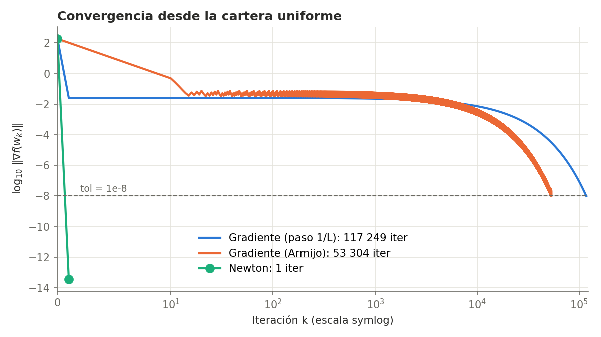
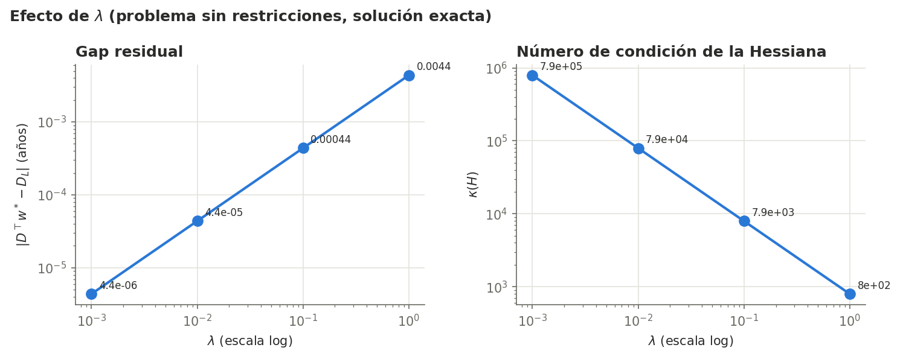

[← Anterior: El modelo](03-modelo.md) · [README](../README.md) · [Siguiente: Fase 2 →](05-fase2-lagrange.md)

# 4. Fase 1: optimización sin restricciones

Módulos: [`src/optimizers.py`](../src/optimizers.py) y [`src/plots.py`](../src/plots.py).

Se resuelve $\min_w f(w)$ sin ninguna restricción. Como $f$ es cuadrática y estrictamente convexa, la solución exacta se conoce en forma cerrada,

$$w^* = \left(DD^\top + \lambda I\right)^{-1}\left(D_L D + \lambda w_0\right),$$

y sirve para comprobar todos los métodos.

## Métodos

- **Descenso por gradiente con paso fijo** $\alpha = 1/L$, donde $L$ es el mayor autovalor de $H$.
- **Descenso por gradiente con búsqueda de Armijo**: se parte de un paso y se divide entre dos hasta que la función baja lo suficiente.
- **Newton**, puro y con búsqueda de Armijo: $w_{k+1} = w_k - \alpha_k H^{-1}\nabla f(w_k)$.

El criterio de parada es $\lVert \nabla f(w_k) \rVert < 10^{-8}$.

## Un problema numérico con Armijo

La condición de Armijo acepta un paso $\alpha$ en la dirección $d$ si

$$f(w + \alpha d) \le f(w) + c\,\alpha\,\nabla f(w)^\top d, \qquad c = 10^{-4}.$$

Cerca del óptimo, con $\lVert\nabla f\rVert \approx 3 \cdot 10^{-8}$, la bajada que se exige es del orden de $10^{-19}$, menor que el error de redondeo con el que se calcula $f$ en doble precisión. La comparación queda dominada por el ruido, la condición falla siempre, el paso tiende a cero y el método se atasca.

La solución es la condición de Wolfe aproximada de Hager y Zhang. Como $f$ es una parábola a lo largo de la recta, la condición de Armijo equivale a

$$\varphi'(\alpha) \le (2c - 1)\,\varphi'(0), \qquad \varphi(\alpha) = f(w + \alpha d),$$

que solo usa derivadas direccionales, calculadas con el gradiente y sin la cancelación que estropea los valores de $f$. Se usa solo cuando la variación de $f$ no se distingue del redondeo.

## Resultados

Iteraciones hasta $\lVert\nabla f\rVert < 10^{-8}$ con $\lambda = 0{,}1$:

| Inicio | Método | Iteraciones | Tiempo |
|---|---|---|---|
| Cartera actual $w_0$ | Gradiente, paso $1/L$ | 1 | 0,1 ms |
| Cartera actual $w_0$ | Gradiente, Armijo | 40 | 4 ms |
| Cartera actual $w_0$ | Newton | 1 | 0,1 ms |
| Cartera uniforme | Gradiente, paso $1/L$ | 117.249 | 2,3 s |
| Cartera uniforme | Gradiente, Armijo | 53.304 | 5,7 s |
| Cartera uniforme | Newton | 1 | 0,2 ms |

- Newton converge en una iteración desde cualquier punto porque $f$ es cuadrática y su modelo de segundo orden es exacto.
- Desde $w_0$, el gradiente también tarda una iteración: en ese punto el gradiente es paralelo a $D$, que es justo el autovector de $H$ con autovalor $L$.
- Desde la cartera uniforme aparece el mal condicionamiento. El error que queda en las direcciones con autovalor $2\lambda$ solo se reduce en un factor $(1 - 1/\kappa)$ por iteración. La teoría predice unas $\kappa \ln(0{,}025/10^{-8}) \approx 1{,}2\cdot10^5$ iteraciones, en línea con las 117.249 observadas.

## El efecto de λ

En el problema sin restricciones, el óptimo es de la forma $w^* = w_0 + tD$ y el desajuste que queda es

$$\text{gap}^* = \frac{\text{gap}_0}{1 + \lVert D\rVert^2/\lambda} = \frac{\text{gap}_0}{\kappa(H)}.$$

El mismo parámetro que mejora el condicionamiento empeora la precisión exactamente en la misma proporción: el producto $\text{gap}^* \cdot \kappa$ es siempre el desajuste inicial, 3,473.

| λ | Desajuste final (años) | κ(H) | gap · κ |
|---|---|---|---|
| 0,001 | 4,373 · 10⁻⁶ | 794.251 | 3,473 |
| 0,01 | 4,373 · 10⁻⁵ | 79.426 | 3,473 |
| 0,1 | 4,373 · 10⁻⁴ | 7.944 | 3,473 |
| 1 | 4,368 · 10⁻³ | 795 | 3,473 |

## Por qué no basta

Los pesos óptimos suman 0,57 para cualquier λ. Sin la restricción de presupuesto, la forma más barata de bajar la duración es encoger la cartera: vender activos y dejar el dinero sin invertir. Además, A02, A03 y A11 reciben peso negativo, es decir, se venden en corto. Ninguna de las dos cosas es admisible, y eso lleva a la [fase 2](05-fase2-lagrange.md).

---

[← Anterior: El modelo](03-modelo.md) · [README](../README.md) · [Siguiente: Fase 2 →](05-fase2-lagrange.md)
