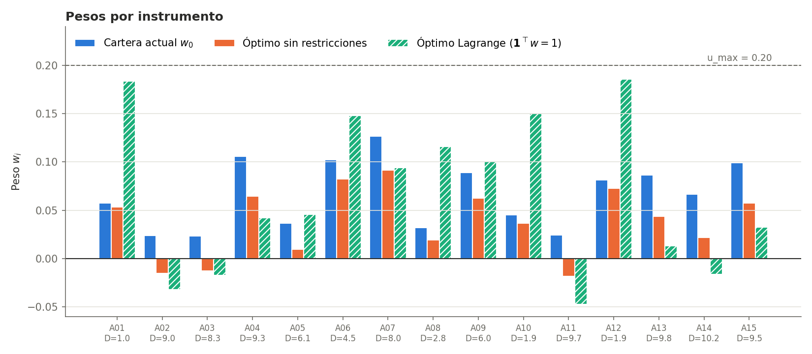

[← Anterior: Fase 1](04-fase1-sin-restricciones.md) · [README](../README.md) · [Siguiente: Fases 3 y 4 →](06-fase3-4-penalizacion-barrera.md)

# 5. Fase 2: restricción de presupuesto con Lagrange

Módulo: [`src/lagrange.py`](../src/lagrange.py).

## Planteamiento

Se resuelve

$$\min_w f(w) \quad \text{s.a.} \quad \mathbf{1}^\top w = 1.$$

La lagrangiana es $\mathcal{L}(w, \nu) = f(w) + \nu\,(\mathbf{1}^\top w - 1)$. Como $f$ es cuadrática, las condiciones KKT forman un sistema lineal:

$$\begin{pmatrix} H & \mathbf{1} \\ \mathbf{1}^\top & 0 \end{pmatrix} \begin{pmatrix} w \\ \nu \end{pmatrix} = \begin{pmatrix} 2\,(D_L D + \lambda w_0) \\ 1 \end{pmatrix}.$$

La matriz es invertible porque $H$ es definida positiva, así que se resuelve directamente con una factorización.

## Resultados y verificación

Se obtiene $f(w^*) = 0{,}007876$, un desajuste de 0,002267 años y $\nu = -0{,}029649$. Se comprobó:

- factibilidad: $\lvert \mathbf{1}^\top w^* - 1 \rvert = 2{,}2 \cdot 10^{-16}$,
- estacionariedad: $\lVert \nabla_w \mathcal{L}(w^*, \nu) \rVert = 1{,}5 \cdot 10^{-14}$,
- coincidencia con `scipy.optimize.minimize` (SLSQP): $\lVert w_{\text{SLSQP}} - w^* \rVert = 4{,}8 \cdot 10^{-14}$.

## Qué significa el multiplicador

Si la restricción fuera $\mathbf{1}^\top w = b$, el teorema de la envolvente da $df^*/db = -\nu$: el multiplicador es el **precio sombra del presupuesto**. Como $\nu < 0$, aumentar el presupuesto empeoraría el objetivo unas 0,0296 unidades por unidad, lo que cuadra con la fase 1, donde la solución libre prefería invertir menos dinero.

## Por qué no basta

La cartera ya invierte el 100 %, pero sigue vendiendo en corto cuatro instrumentos largos:

| Instrumento | Duración | Peso con Lagrange |
|---|---|---|
| A02 | 9,00 | −0,0318 |
| A03 | 8,33 | −0,0172 |
| A11 | 9,69 | −0,0472 |
| A14 | 10,18 | −0,0162 |

Para prohibir los pesos negativos y limitar cada peso al 20 % hacen falta restricciones de desigualdad, que se tratan en las [fases 3 y 4](06-fase3-4-penalizacion-barrera.md).

---

[← Anterior: Fase 1](04-fase1-sin-restricciones.md) · [README](../README.md) · [Siguiente: Fases 3 y 4 →](06-fase3-4-penalizacion-barrera.md)
