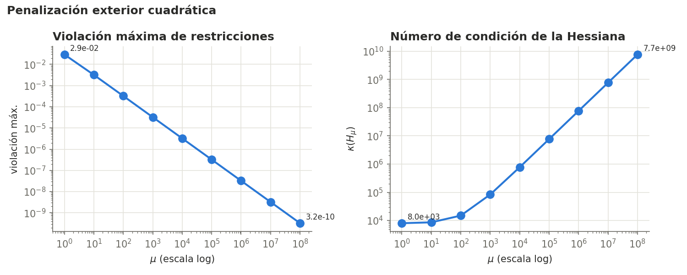
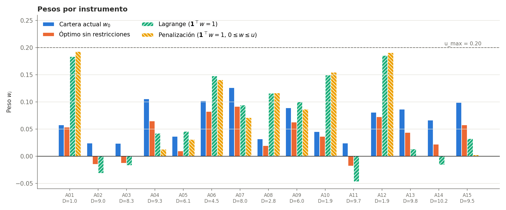
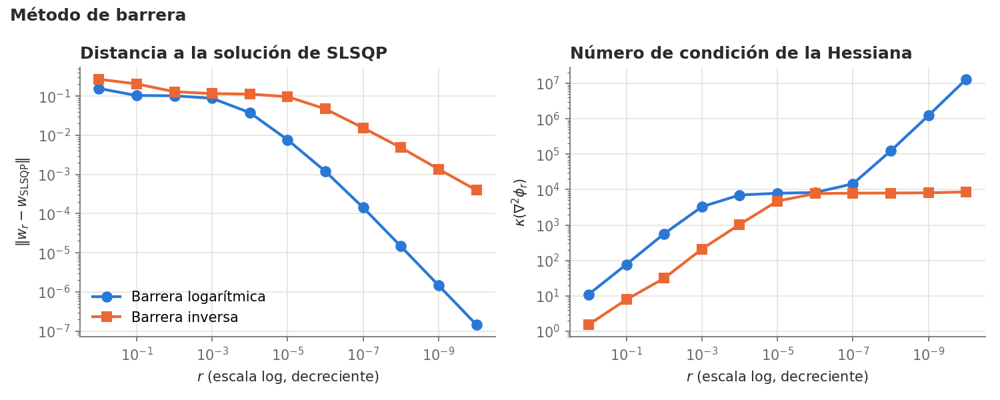
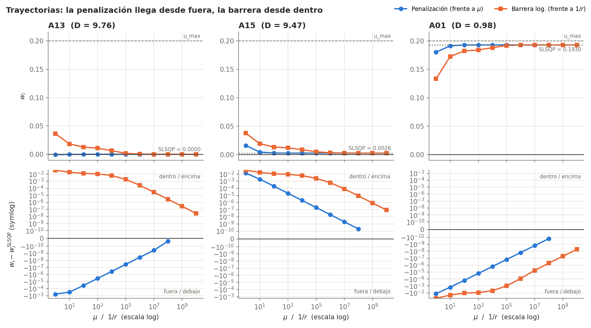

[← Anterior: Fase 2](05-fase2-lagrange.md) · [README](../README.md) · [Siguiente: Fase 5 →](07-fase5-turnover.md)

# 6. Fases 3 y 4: penalización y barrera

Módulos: [`src/penalty.py`](../src/penalty.py) y [`src/interior_point.py`](../src/interior_point.py).

Ahora el problema es

$$\min_w f(w) \quad \text{s.a.} \quad \mathbf{1}^\top w = 1, \quad 0 \le w_i \le u_i.$$

Se resuelve de dos formas que se acercan al óptimo desde lados opuestos.

## Fase 3: penalización exterior

Se permite salirse del conjunto factible, pero se cobra una multa que crece con $\mu$:

$$P_\mu(w) = f(w) + \frac{\mu}{2}\left[(\mathbf{1}^\top w - 1)^2 + \sum_i \max(0, -w_i)^2 + \sum_i \max(0, w_i - u_i)^2\right].$$

Se resuelve con Newton y Armijo para $\mu = 1, 10, \dots, 10^8$, empezando cada subproblema en la solución del anterior.

- **La violación baja como $1/\mu$.** Desde $\mu = 100$, la violación por $\mu$ vale siempre 0,0324, que es $\lvert\nu\rvert$. Los pesos que deberían ser cero valen $-\lambda_i/\mu$: la penalización llega al óptimo **desde fuera**.
- **El condicionamiento crece como $\mu$**, hasta $\kappa \approx 7{,}7 \cdot 10^9$ con $\mu = 10^8$.
- **Una iteración de Newton por subproblema** desde $\mu = 10$: con el arranque en caliente, el conjunto activo ya es el correcto y $P_\mu$ es cuadrática en ese trozo.
- **Suelo numérico** para $\mu \ge 10^7$: el redondeo multiplicado por $\mu$ impide bajar el gradiente de $10^{-8}$. Es la debilidad clásica del método. Con $\mu = 10^6$ la violación ($3\cdot10^{-8}$) ya es despreciable.

La solución coincide con la de SLSQP ($\lVert w_{\text{pen}} - w_{\text{SLSQP}}\rVert = 4{,}6\cdot10^{-10}$), con $f = 0{,}0085628$, un desajuste de 0,00273 años y un turnover de 0,955. Cinco instrumentos largos (A02, A03, A11, A13 y A14) quedan a cero.

### La duración pivote

Para los instrumentos que no tocan ningún límite, la solución cumple

$$w_i^* = w_{0,i} - \frac{\text{gap}^*}{\lambda}\,(D_i - D^*), \qquad D^* = \frac{-\nu}{2\,\text{gap}^*} \approx 5{,}93 \text{ años}.$$

Los instrumentos con duración mayor que 5,93 años pierden peso y los de duración menor lo ganan. Por ejemplo, A09 ($D = 6{,}03$) apenas baja de 0,089 a 0,087 y A06 ($D = 4{,}52$) sube de 0,102 a 0,141.

## Fase 4: barrera (punto interior)

Aquí se hace lo contrario: no se deja salir nunca. Las desigualdades se sustituyen por una barrera que se va a infinito en el borde:

$$B_{\log}(w) = -\sum_i \left[\ln w_i + \ln(u_i - w_i)\right], \qquad B_{\text{inv}}(w) = \sum_i \left[\frac{1}{w_i} + \frac{1}{u_i - w_i}\right],$$

y para $r = 1, 10^{-1}, \dots, 10^{-10}$ se resuelve

$$\min_w \; f(w) + r\,B(w) \quad \text{s.a.} \quad \mathbf{1}^\top w = 1$$

con Newton con restricción de igualdad. Cada paso se limita al 99 % de la distancia al borde, así que todos los iterados son carteras válidas. La cartera actual es estrictamente factible y sirve como punto de partida.

| Método | $f(w)$ | Violación máx. | Turnover | Iteraciones |
|---|---|---|---|---|
| Penalización ($\mu = 10^6$) | 0,008562829971 | 3 · 10⁻⁸ | 0,955 | 9 |
| Barrera logarítmica | 0,008562832076 | 4,4 · 10⁻¹⁶ | 0,955 | 76 |
| Barrera inversa | 0,008567687188 | 2,2 · 10⁻¹⁶ | 0,955 | 54 |
| SLSQP | 0,008562831590 | 1,1 · 10⁻¹⁶ | 0,955 | – |

- **Precisión.** La barrera logarítmica reduce el error un factor 10 por cada década de $r$; la inversa, solo un factor $\sqrt{10}$, porque en un peso que acaba en cero da $w_i = \sqrt{r/\lambda_i}$ en vez de $r/\lambda_i$.
- **Coste.** La penalización solo necesita 9 iteraciones de Newton en total; las barreras, 76 y 54, porque sus subproblemas no son cuadráticos.
- **Factibilidad.** Las barreras cumplen las restricciones con error de redondeo en todas las iteraciones; la penalización, no.

### Cotas por los dos lados

La penalización da puntos infactibles con $f(w_\mu) \le f^*$ y la barrera, puntos factibles con $f(w_r) \ge f^*$. Juntas encierran el óptimo:

$$0{,}008562829971 \le f^* \le 0{,}008562832076,$$

y el valor de SLSQP cae dentro.

En A13, cuya restricción $w_i \ge 0$ está activa, la penalización llega con pesos ligeramente negativos y la barrera con pesos ligeramente positivos. Si el algoritmo se para antes de tiempo, la barrera entrega una cartera que se puede invertir y la penalización no.

### El número 5

Con la barrera logarítmica, a partir de $r = 10^{-6}$ la distancia al óptimo es exactamente $f(w_r) - f^* = 5r$. La explicación es que los pesos de las restricciones activas valen $w_i \approx r/\lambda_i$, y entonces

$$f(w_r) - f^* \approx \sum_{i \in \mathcal{A}} \lambda_i \cdot \frac{r}{\lambda_i} = \lvert\mathcal{A}\rvert\, r,$$

donde $\mathcal{A}$ son las restricciones activas. Aquí hay cinco: los pesos nulos de A02, A03, A11, A13 y A14.

---

[← Anterior: Fase 2](05-fase2-lagrange.md) · [README](../README.md) · [Siguiente: Fase 5 →](07-fase5-turnover.md)
