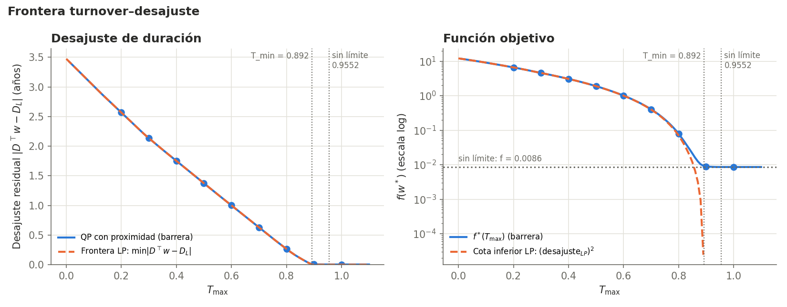
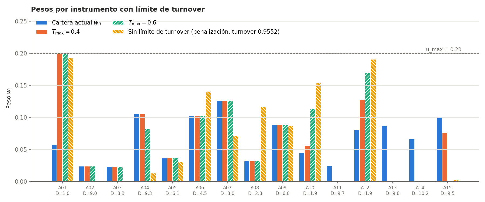

[← Anterior: Fases 3 y 4](06-fase3-4-penalizacion-barrera.md) · [README](../README.md) · [Siguiente: Fase 6 →](08-fase6-escenarios.md)

# 7. Fase 5: presupuesto de rebalanceo

Módulo: [`src/turnover.py`](../src/turnover.py).

En la realidad un banco no puede reestructurar toda su cartera de una vez. Se añade un límite al volumen que se mueve:

$$\sum_i \lvert w_i - w_{0,i} \rvert \le T_{\max}.$$

## Variables positivas-negativas

El valor absoluto no es derivable. Siguiendo el temario, cada cambio se separa en una compra $p_i$ y una venta $q_i$:

$$w = w_0 + p - q, \qquad 0 \le p_i \le u_i - w_{0,i}, \qquad 0 \le q_i \le w_{0,i}.$$

Las cotas de $p$ y $q$ ya garantizan $0 \le w_i \le u_i$, el presupuesto pasa a ser $\mathbf{1}^\top p = \mathbf{1}^\top q$ y la restricción de rebalanceo se vuelve lineal:

$$\mathbf{1}^\top p + \mathbf{1}^\top q \le T_{\max}.$$

Cuando la restricción no está activa, $(p, q)$ no es único (comprar y vender lo mismo no cambia $w$), así que el turnover real se calcula siempre a partir de $w$.

## Turnover mínimo

El menor rebalanceo que cierra el desajuste por completo sale de un programa lineal: $T_{\min} = 0{,}892$. Esa cartera compra A01, A12 y A10 hasta el 20 % y algo de A08, y vende por completo A14, A13, A11, A15, A04, A02 y A03.

La solución sin límite de las fases anteriores usa un turnover de 0,955, solo un 7 % más que el mínimo: casi todo lo que mueve es imprescindible.

## La frontera turnover-desajuste

Para cada presupuesto se calcula el menor desajuste posible con un programa lineal:

| $T_{\max}$ | 0,1 | 0,2 | 0,3 | 0,4 | 0,5 | 0,6 | 0,7 | 0,8 | 0,892 |
|---|---|---|---|---|---|---|---|---|---|
| Desajuste (años) | 3,013 | 2,567 | 2,135 | 1,751 | 1,374 | 1,000 | 0,630 | 0,265 | 0 |

La regla es voraz: **se vende el instrumento más largo y se compra el más corto**, agotando cada uno antes de pasar al siguiente. En cada tramo el desajuste baja con pendiente

$$\frac{d\,\text{gap}}{dT_{\max}} = -\frac{D_v - D_c}{2},$$

donde $D_v$ y $D_c$ son las duraciones de lo que se vende y de lo que se compra. Es una mochila fraccionaria. El primer tramo vende A14 ($D = 10{,}18$) para comprar A01 ($D = 0{,}98$), con pendiente 4,60, que coincide con la caída entre $T = 0$ y $T = 0{,}1$.

## El problema completo

Para cada $T_{\max} \in \{0{,}2, \dots, 1{,}0\}$ se resuelve el problema con la función objetivo completa en las variables $(p, q) \in \mathbb{R}^{30}$, con una barrera logarítmica sobre las 61 desigualdades. Se comprobó contra SLSQP en los nueve casos ($\lVert w - w_{\text{SLSQP}}\rVert \le 1{,}8\cdot10^{-7}$) y con las condiciones KKT.

## Precio sombra del rebalanceo

El multiplicador $\tau$ de la restricción de turnover dice cuánto mejora el objetivo por cada unidad más de rebalanceo. Mientras el desajuste es grande,

$$\tau \approx \text{gap}^*\,(D_v - D_c).$$

| $T_{\max}$ | Vende | Compra | Aproximación | $\tau$ exacto |
|---|---|---|---|---|
| 0,2 | A13 | A01 | 22,55 | 22,54 |
| 0,4 | A15 | A12 | 13,21 | 13,21 |
| 0,6 | A04 | A12 | 7,41 | 7,40 |
| 0,8 | A02 | A10 | 1,88 | 1,86 |

El rebalanceo tiene rendimientos decrecientes: las primeras unidades valen mucho porque se usan en las mejores operaciones, y el precio sombra se anula a partir de 0,955.

## Rebalanceo disperso

Con $T_{\max} = 0{,}4$, ocho de los quince instrumentos conservan exactamente su peso. La restricción de turnover es una norma $L_1$ y, como en la regresión LASSO, concentra los cambios en pocas operaciones. Sin límite, el término de proximidad (una norma $L_2$) reparte los cambios entre casi todos.

---

[← Anterior: Fases 3 y 4](06-fase3-4-penalizacion-barrera.md) · [README](../README.md) · [Siguiente: Fase 6 →](08-fase6-escenarios.md)
