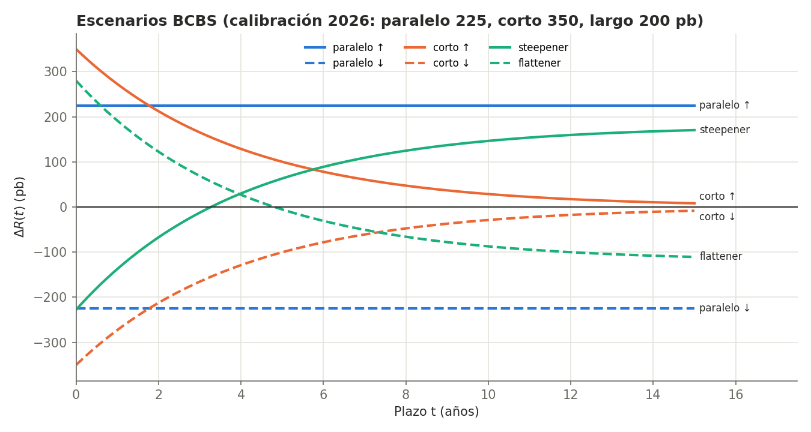
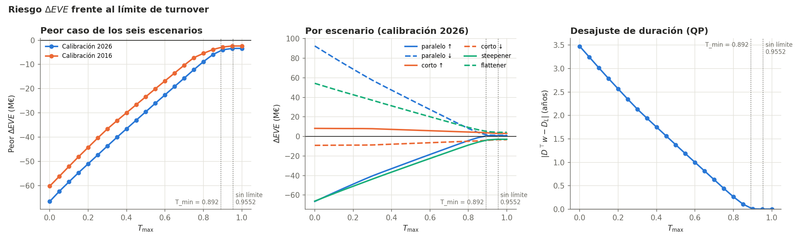

[← Anterior: Fase 5](07-fase5-turnover.md) · [README](../README.md) · [Siguiente: El código →](09-codigo.md)

# 8. Fase 6: escenarios de Basilea

Módulo: [`src/scenarios.py`](../src/scenarios.py).

Igualar duraciones es una aproximación de primer orden. Esta fase comprueba si la recomposición reduce de verdad el riesgo, revalorizando todos los flujos de caja ante los escenarios de crisis del Comité de Basilea y midiendo

$$\Delta EVE = \Delta V_A - \Delta V_L.$$

## Modelo de valoración

- **Activos.** Cada instrumento conserva sus flujos. En el escenario base se descuentan a su rentabilidad $y_i$; en un escenario, el flujo del instante $t$ se descuenta a $y_i + \Delta R(t)$.
- **Pasivos.** Cada bloque se modeliza como un bono cupón cero con vencimiento elegido para que su duración modificada sea la del bloque (4,621, 1,841 y 0,613 años).
- **Tamaño.** Se supone $V_A = V_L = 1.000$ M€. Igualar duraciones solo inmuniza el valor económico si los dos lados valen lo mismo.

## Los seis escenarios

A partir de una perturbación de los tipos cortos y otra de los largos,

$$\Delta R_{\text{corto}}(t) = \bar R_{\text{corto}}\, e^{-t/4}, \qquad \Delta R_{\text{largo}}(t) = \bar R_{\text{largo}}\left(1 - e^{-t/4}\right),$$

se construyen la subida y la bajada paralela, la subida y la bajada de los cortos, el empinamiento ($-0{,}65\,\Delta R_{\text{corto}} + 0{,}9\,\Delta R_{\text{largo}}$) y el aplanamiento ($0{,}8\,\Delta R_{\text{corto}} - 0{,}6\,\Delta R_{\text{largo}}$).

La calibración principal es la del euro vigente desde 2026: 225 p.b. en paralelo, 350 en cortos y 200 en largos. Como comparación se usa la de 2016 (200, 250 y 100).

## Resultados

$\Delta EVE$ en M€ con la calibración de 2026. La última columna es el peor de los seis escenarios.

| Cartera | Turnover | Paral. ↑ | Paral. ↓ | Corto ↑ | Corto ↓ | Empina | Aplana | Peor |
|---|---|---|---|---|---|---|---|---|
| Actual | 0 | −66,49 | +92,49 | +8,23 | −9,13 | −66,14 | +54,30 | **−66,49** |
| $T_{\max} = 0{,}4$ | 0,4 | −32,97 | +47,36 | +7,21 | −7,94 | −36,50 | +31,28 | −36,50 |
| $T_{\max} = 0{,}8$ | 0,8 | −4,26 | +8,15 | +4,51 | −4,93 | −8,86 | +9,22 | −8,86 |
| Turnover mínimo | 0,892 | +0,90 | +1,21 | +3,89 | −4,25 | −3,71 | +5,16 | −4,25 |
| Sin límite | 0,955 | +0,73 | +1,13 | +3,11 | −3,38 | −2,91 | +4,20 | **−3,38** |

La pérdida en el peor escenario pasa de **66,5 M€ a 3,4 M€, un 95 % menos**. Tras la recomposición, ningún escenario mueve el valor económico más de 4,2 M€.

## Convexidad

La cartera optimizada gana un poco tanto si los tipos suben como si bajan (+0,73 y +1,13 M€). Su desajuste de duración es casi nulo, así que lo que queda es el efecto de segundo orden, la convexidad: $\tfrac12 \cdot 3{,}65 \cdot 1.000 \cdot 0{,}0225^2 \approx 0{,}92$ M€, positivo en los dos sentidos.

## Lo que no cubre: la pendiente

La cartera optimizada conserva unos 3-4 M€ de riesgo frente a los cambios de pendiente. Los pasivos se concentran en el tramo medio (los depósitos core), mientras que la cartera iguala esa duración mezclando instrumentos muy cortos y algunos largos, una estructura *barbell*. Un movimiento paralelo afecta igual a todos los tramos y se compensa; uno de pendiente, no.

Por eso **desajuste cero no es lo mismo que riesgo mínimo**: la cartera de turnover mínimo, con desajuste exactamente nulo, pierde 4,25 M€ en su peor escenario frente a los 3,38 de la solución con término de proximidad, que reparte mejor los cambios.

## Riesgo frente a rebalanceo

El peor $\Delta EVE$ mejora casi linealmente con el turnover, unos 7 M€ por cada 0,1 de rebalanceo, hasta $T_{\min}$, y después se estabiliza en torno a −3,4 M€. Esta relación traduce una decisión de gestión (cuánto rebalancear) en riesgo evitado en euros.

## Trabajo futuro

- Casar duraciones por tramos de vencimiento (*key rate durations*).
- Minimizar directamente el peor $\Delta EVE$ de los seis escenarios. Como cada $\Delta EVE$ es lineal en los pesos, sigue siendo un programa lineal.
- Incorporar la convexidad a la función objetivo.
- Aplicar la metodología a datos reales.

---

[← Anterior: Fase 5](07-fase5-turnover.md) · [README](../README.md) · [Siguiente: El código →](09-codigo.md)
